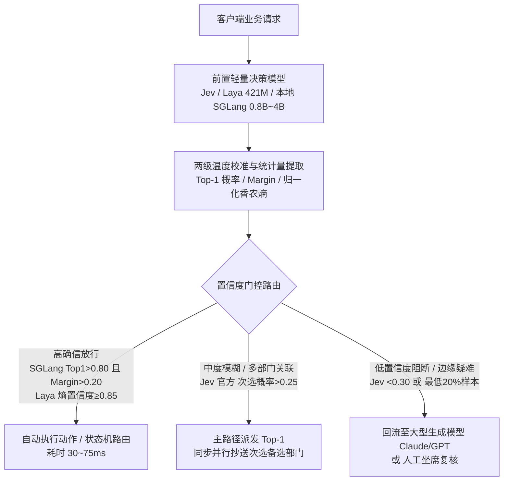

# 决策模型的概率校准、置信度级联与端侧平替账单

在上一篇《[[raw/out-blogs/给语言模型装一个动态分类头|给语言模型装一个动态分类头]]》里，我们聊过怎么砍掉大模型的自回归生成循环，用单次前向传播抽出候选标记的分值，或者像 [[entities/实体_Laya|Laya]] 那样靠双向编码器加动态 `[MASK]` 拼出一个三十多毫秒的分类头。

架构跑通之后，真正卡住生产落地的往往是后半截问题。

业务代码拿到模型吐出来的 0.85，凭什么相信它在十次里真能蒙对八九次？如果各个候选选项之间需要横向比较，独立打分头会不会漏掉线索？线上把轻量决策模型和大型生成模型串成级联网关时，阈值到底卡在哪里最省钱？面对商业黑盒 API [[entities/实体_Jev|Jev]]，我们在本地拿开源小模型直接抽受限 Logits 再配一层校准，到底能不能平替？

这篇专门把这几笔硬核的数学账和工程账算清楚。

---

## 一、五大架构谱系与打破“盲审”的跨候选比对

随着 [[entities/实体_Jev|Jev]]、[[entities/实体_Laya|Laya]] 和 Cloudflare Clef 相继走红，魔搭社区的 [[entities/实体_ms-swift|ms-swift]] 团队把目前的专用决策模型梳理成了五条技术路线。

```
                              [专用决策模型五大路线]
                                        │
     ┌──────────────────┬───────────────┼───────────────┬──────────────────┐
     ▼                  ▼               ▼               ▼                  ▼
[Token 读出型]    [隐状态读出型]  [联合解码器型]  [逐候选显式交互型]  [多模态专用型]
(JEV-27B-VL)       (Laya 421M)      (Clef)          (NanoJev)          (OmniJev)
词表层抽单字符分值 骨干网络挂打分头 联合注意力建模  候选与背景拼接编码  视觉底座结合有序头
```

第一条路是 **Token 读出型**（如 JEV-27B-VL、SGLang `/v1/score`），直接复用因果语言模型的词表层，抽出 `A`、`B`、`C` 或 `True`、`False` 单字符分值做局部归一化，挂个 [[concepts/概念_LoRA_低秩适应微调|LoRA]] 就能跑。第二条路是 **隐状态读出型**，不走词表生成，直接在骨干网络隐状态上挂标量打分头，跨源代表 Laya 就是用 ModernBERT 加 `[MASK]` 抽取向量打分。第三条路是 **联合解码器型**（如 Clef），用专门的联合注意力层去捕捉多道问题之间的交叉依赖，一次前向吐出整张表单的联合概率。第四条路是 **逐候选显式交互型**（如 `ms-swift` 定义下的 NanoJev），把每个候选项分别跟背景状态拼成完整序列，逐个送进模型编码打分再汇总归一化，能吃透极复杂的选项描述，代价是计算量随候选数线性往上涨。第五条路是 **多模态专用型**（如 OmniJev），把视觉编码器与有序评分头结合起来处理带图判定。

在这五类架构里，有一个非常容易被忽视的细节。

如果模型只是给每个选项接一个独立的线性头分别打分，那各选项之间就相当于“盲审”。按照概率论里的独立无关备选假设（IIA），往题目里新塞一个毫不相干的陪跑选项，原有选项之间的概率比值应该纹丝不动。但《一文拆解 Jev 架构》在黑盒测试里发现，往多选一（`Choice`）题目里塞入无关干扰项，原有选项之间的相对赔率会发生明显偏移。

这说明高阶决策模型内部一定有让各个候选项同台比对的机制。目前开源社区拆解出了两种具体做法。

一种是开源复现项目 `Kev` 采用的**指针头（Pointer Head）**，好比同场群面。模型把长背景和所有候选选项一次性拼在同一条序列里单次通读，在序列末尾特定位置生成一个全局指针向量，回头去指前文各个候选项对应的隐状态计算匹配分。

另一种是 `NanoJev` 采用的**候选间注意力模块（Inter-candidate Attention Module）**，好比评委会讨论。每个候选选项先各自抽出特征表示向量，随后统一送进一层专门的跨候选自注意力（Self-Attention）网络互相拉踩比对，把竞争选项本身也当成解题线索，最后再输出归一化概率。

---

## 二、训练期校准（ms-swift 监督损失 vs Laya RLCD 强化学习）

搭好跨候选交互结构之后，紧接着要解决深度学习的老毛病，过度自信（Overconfidence）。

无论是卷积网络还是 Transformer，只要用常规硬标签交叉熵训练，模型就会拼命把正确类别的 Logits 往无穷大推。比如 ResNet 在 CIFAR-100 上平均自报把握高达百分之九十，拉到测试集上一看实际准确率只有百分之七十左右。这种虚高的数字根本没法直接写进业务代码的阈值判断里。

要让模型老实交代真实把握，数学上必须引入**严格适当评分规则（Strictly Proper Scoring Rules）**。设客观环境的真实分布为 $p$，模型报出的概率分布为 $q$，评分函数 $S(q, y)$ 衡量真实结果 $y$ 发生时的得分。当且仅当模型如实报告真实后验信念（$q = p$）时，期望得分才能达到唯一全局最优

$$\mathbb{E}_{y \sim p}[S(p, y)] \ge \mathbb{E}_{y \sim p}[S(q, y)], \quad \forall q$$

围绕这条数学性质，工业界演化出了**监督微调损失（`ms-swift`）**与**纯强化学习奖励（`Laya RLCD`）**两条训练路线。

```
                         [严格适当评分规则训练双路线]
                                      │
          ┌───────────────────────────┴───────────────────────────┐
          ▼                                                       ▼
[路线 A 监督/蒸馏微调损失 (ms-swift)]               [路线 B 纯强化学习奖励 (Laya RLCD)]
  ├─ 统一 Loss 路线 (JEV / Clef / OmniJev)          ├─ 监督交叉熵损失严格设为 0
  │    共享基础项 (FP32 无截断掩码软交叉熵)            ├─ 策略探索 G=8 零均值高斯噪声采样 + GRPO 组均值基线
  │    + 专用校准项 (RPS / Brier / 序数 CE)          ├─ 信用分配 TD(λ=1.0) 前缀切分多步轨迹传递
  └─ 分题型 Loss 路线 (NanoJev)                     └─ 复合严格适当奖励
       Choice 用 CE / Noul 用 BCE / Score 用序数 CE        S_log (带 -9.21 截断下限) + S_sph (球面评分) + S_rps
```

### 1. ms-swift 的监督与蒸馏微调损失谱系

[[entities/实体_ms-swift|ms-swift]] 支持两条支线。一条是 NanoJev 的分题型路线（多选一用交叉熵 CE、是非题用二元交叉熵 BCE、打分题用序数交叉熵）；另一条是 JEV、Clef 和 OmniJev 采用的统一损失路线，把目标拆成**共享基础项**加**专用校准项**。

共享基础项采用**掩码软交叉熵（Log Score）**，在教师蒸馏软目标下等价于最小化 KL 散度。这里有一个极关键的工程红线，`ms-swift` 强制使用单精度（FP32）做掩码计算，而且**在监督微调里绝对不截断概率（No Clipping）**。一旦为了防溢出把极小概率截断，模型在做出高确信误判时就收不到足够陡峭的惩罚梯度，校准效果会大打折扣。

专用校准项则重点引入了**有序概率得分（Rank Probability Score, RPS）**与 **Brier 得分**。其中 RPS 专门对付分级打分题（`Score`），计算预测累积分布函数（CDF）与真实累积分布在各档位上的距离平方和

$$\text{RPS} = \sum_{m=1}^{K-1} \left( \sum_{k=1}^m q_k - \sum_{k=1}^m y_k \right)^2$$

把五星好评错判成一星差评，中间隔了四个累积阶梯，RPS 算出来的惩罚会比错判成四星重得多。`ms-swift` 将这些组件封装成了四套现成配方，分别是适配 JEV-27B-VL 的教师蒸馏加 RPS（`distill_rps`）、适配 Clef 的标签平滑加 Brier（`smooth_brier`）、适配 OmniJev 的交叉熵加 RPS（`ce_rps`）以及基础纯评分模式（`scoring`）。

### 2. Laya 的校准决策强化学习（RLCD）

[[entities/实体_Laya|Laya]] 走的 [[concepts/概念_RLCD校准决策强化学习|RLCD]] 路线更激进，它直接**把监督式交叉熵损失设为零**，全程靠策略梯度优化三项严格适当评分组成的复合奖励。

第一项还是对数评分 $S_{log}$。跟监督微调相反，因为在强化学习的随机采样里，抽中极低概率动作很容易炸穿策略梯度，Laya 专门给对数评分设了 `-9.21` 的截断下限（对应概率下界约 $10^{-4}$）。为了弥补截断损失的边界梯度，它紧接着配上了第二项**球面评分（Spherical Score）**

$$S_{sph}(q, y) = \frac{q(y)}{\|q\|_2}$$

球面评分的梯度天然有界且平滑，刚好把对数评分在极小概率区的剧烈震荡抚平。第三项同样挂上排序概率评分 $S_{rps}$ 约束序数打分。

训练时，Laya 对每个样本在评分头输出的 Logits 上注入 $G=8$ 组零均值高斯噪声 $\epsilon \sim \mathcal{N}(0, \sigma^2 I)$ 探索不同分布，用 GRPO 拿组内八次采样的均值当低方差基线。遇到长对话流式判断，它还会把上下文按百分之二十到百分之一百的前缀切成五个时间步，借用 $TD(\lambda=1.0)$ 把最终水落石出时的校准奖励一路回传给早期前缀，逼着模型在信息不全的对话初期学会按下自信度。

---

## 三、推理期校准与两级温度标定下的置信度级联经济账

即便训练阶段用了适当评分规则，模型上线后遇到分布偏移（OOD）或不同题型混合调用，置信度还是会出现系统性漂移，需要在推理端补一道事后校准（Post-hoc Calibration）。

早期的 Platt 缩放是在独立校准集上冻结特征去拟合逻辑回归（Sigmoid 映射），在二分类上好用，但样本太少容易把参数拟合歪。大模型推理更常用温度缩放（Temperature Scaling），拿单一正数温度 $T$ 缩放分值 $q_k = \frac{\exp(z_k / T)}{\sum \exp(z_j / T)}$。除以正数是严格单调变换，不会改变任何一题的准确率与选项排序，只把概率分布拉平或拉陡。

但 [[entities/实体_ms-swift|ms-swift]] 团队在实测中发现，同一个决策模型在不同原语题型上脾气截然相反，往往在是非题（`Noul`）上畏首畏尾欠自信，到了打分题（`Score`）上又盲目乐观过自信。全模型共用一个温度，按下葫芦就会浮起瓢。为此他们设计了**两级温度标定（Two-Level Temperature Calibration）**，把实际生效温度拆成两项连乘

$$\tau_{effective} = \tau_{global} \times \tau_{task\_relative}$$

先用全局温度 $\tau_{global}$ 把模型整体的冷热偏差拉回正轨，再乘上题型相对温度 $\tau_{task\_relative}$ 单独纠偏各题型。在样本外两折交叉验证里，这套两级标定把 Jev 模型的期望校准误差（ECE）从 0.00268 一举压到了 0.00143，降幅高达 **46.7%**，Brier 得分也同步下降了 **9.5%**。

有了这套校准托底，把轻量决策模型放在最前面当反射网关、大型生成模型放在后面兜底的**置信度级联（Confidence Cascading）**就能算清经济账了。



不同文献给出了四组可以直接对标参考的级联门控口径。

第一组是**本地 SGLang `/v1/score` 双阈值口径**（《Build your own Jev》），同时卡死最高项绝对概率 `top1 > 0.80` 与前两名胜出裕度 `Margin = top1 - top2 > 0.20`，双达标才毫秒级放行。

第二组是 **Laya 归一化香农熵口径**（《Laya 开源白皮书》），按 $C = 1 - \frac{H(p)}{\log K}$ 计算把握。当卡死高阈值 $C \ge 0.85$ 时，Laya 能自动处理 **50%** 的请求，子集准确率达 **92.2%**；放宽阈值吃下 **80%** 自动流量时，子集准确率依然稳在 **89.4%**，仅留 20% 疑难杂症交给后台。

第三组是 **Jev 官方工单三层路由口径**（《更好的替代品早已存在》引述）。最高把握低于 `0.30`（或落在 `0.30~0.70` 模糊带）直接转人工；过线则派给第一名部门；同时多看一眼第二名，只要**次选部门概率 `> 0.25`**，系统在派发主部门时会**同步并行抄送（CC）**次选部门一块儿跟进。

第四组是**韩美医学执照考试大模型复核账单**（《ms-swift》引述的 2026 年 10 月研究）。评测 Jev、OpenAI Decisions 与 Clef 时发现，把模型把握最低的 **20% 样本**拎出来，里面集中抓到了全部错题的 **56%～91%**（韩文考题覆盖 56%～91%，英文考题覆盖 62%～72%）。只要把这最没底的 20% 样本定向送给大型生成模型复核，整体考试准确率立马拔高 **6～9 个百分点**，而整套系统的算力总开销只有全量调大模型的 **25%～33%**。

---

## 四、云端黑盒 vs 端侧平替的正反方实证交锋

围绕“商业决策 API 到底有没有不可替代的护城河”，开源社区与商业模型支持者打出了一轮非常精彩的实证交锋。

[[entities/实体_鸭哥|鸭哥]]与何码先生汇总了开源项目（`SemIf`、`jev-fire`、`truestandard.ai`）对 Jev 的独立审计，从四个维度直接叫板云端黑盒。

| 评测维度 | 商业云服务 Jev | 开源端侧 / 本地平替方案 | 核心实证结论 |
| --- | --- | --- | --- |
| **判断一致率** | **88.3%**（102 项官方测试集） | **84.5%**（`SemIf` 冻结 Qwen3.5-4B，零微调直接抽首 Token Logits） | 零训练现成 4B 小模型仅落后 Jev **3.8 个百分点**。 |
| **校准误差 (ECE)** | **0.066**（`truestandard.ai` 跨 6 领域 108 命题） | Gemini 3.1 Flash Lite (**0.061**)、Claude Haiku 4.5 (**0.067**) | 通用轻量模型配合 200~300 条样本做 Platt Scaling 或温度缩放即可拉平 ECE。 |
| **端到端延迟** | 云端中位延迟 **178 ms** | **`jev-fire`** 0.8B Qwen 经 WebGPU 在浏览器本地运行仅 **71.26 ms**；[[entities/实体_Laya|Laya]] 421M 仅 **33~38 ms** | 省去公网 RTT 后，端侧亚十亿级小模型比云端 API 快 2~5 倍且零调用费。 |
| **输出确定性** | **存在随机抖动**（同一输入连测 15 次，概率在 `0.43~0.53` 摆动，横穿 0.5 阈值） | **100% 确定性输出**（本地固定权重与算子，同输入永远给出完全一致的浮点数） | 云端动态批处理与非确定性 GPU 归约算子导致边界摆动，对合规审计构成隐患。 |

反方认为，单次前向抽 Logits 加温度缩放早已是推理引擎的基础设施。Jev 测出来的 ECE（0.066）跟 Gemini 3.1 Flash Lite（0.061）几乎没拉开差距，业务团队自己攒两三百条标注样本跑一遍 Platt Scaling 就能在本地追平，还能彻底避开云端动态凑批（Dynamic Batching）带来的概率抖动。

另一边，《一文拆解 Jev 架构》《Laya 开源》与《ms-swift》则指出了“零微调抽现成因果模型首 Token + 简单温度缩放”跨不过去的两道坎。

第一道坎是**教师蒸馏的主观偏见继承**。很多开源复刻方案拿大模型打软标签再去蒸馏小模型，学生模型学到的只是教师模型的主观语言偏好（Subjective Belief），遇到教师模型自己常犯的盲目自信也会照单全收，并不能反映客观世界的真实统计频率。

第二道坎是**事后温度缩放无法习得“无证据边界辨别力”**。在测试集上拧温度参数 $T$，只能把整条自信度曲线统一压低或抬高，却没法教会模型在证据缺失时主动承认“我不知道”。一个真正校准到位的决策模型，碰到背景材料残缺、正反都说得通的模糊输入时，应该主动退回到 0.5 附近的最大熵状态。这种能力靠事后除个常数除不出来，必须在训练期专门构造“证据不足（Insufficient Evidence）”对抗样本，配合严格适当评分规则或 RLCD 修改模型权重。

此外，[[entities/实体_鸭哥|鸭哥]]还澄清了浏览器智能体（Browser Agent）提速的真实归因。很多评测把网页操作变快归功于换上了 Jev，但消融对比显示，头号功臣其实是前端感知表征清洗。比如引入 [[concepts/概念_WebMCP_浏览器原生工具协议|WebMCP]] 把几万字脏乱的原始 DOM 树转成干净的结构化工具契约之后，仅靠前端降噪这一步，任务完成率就从 **25/49 跳到了 49/49（100%）**，单步耗时从 **5.4 秒降到 3.2 秒**。如果前端喂进去的依然是脏乱 HTML，光在末端换个再快的判断模型也救不回准确率。

---

## 五、生产落地的三条死穴

把决策模型真正接进业务流水线之前，还有三条硬边界必须提前防住。

1. **严禁拿它硬做多步长程推理与算术题**。无自回归决策模型砍掉了逐词生成，也就等于没收了思维链（CoT）暂存中间计算结果的草稿纸。实测 Jev 在困难推理题上的准确率只有 **74.1%**（通用大模型为 **95.0%**），碰到两步算术应用题正确率直接跌到 **32%**。数值计算、日期比对和确定性规则检验一律交给原生代码处理，决策模型只干单步语义判定的活。
2. **防范位置呈现敏感性（Position Sensitivity）**。模型对关键事实摆在输入文本的哪个位置依然非常敏感。实验里把同一条关键因果事实从文本开头挪到中间段落，判断正确率直接从 **80.5% 腰斩到 40.9%**。前置数据清洗管道应当把核心指标与关键事实统一提炼到 `State` 开头。
3. **警惕串联调用引发的延迟与成本倒挂**。决策模型省钱省时间的前提，是它能在前面直接拦截并终结掉五到八成的常规请求。如果业务规定不管决策模型判出什么结果，后面都得无条件再调一次大型生成模型，那在前面串一道云端决策 API 纯属帮倒忙。实测把两者盲目串联后，Agent 端到端总延迟反而从 **649 毫秒暴涨到 1087 毫秒**。同时，受限候选列表里必须永远保留显式的 `OTHER` 或 `ESCALATE` 兜底选项，防止范围外的异常输入被强行分摊给已知部门。
