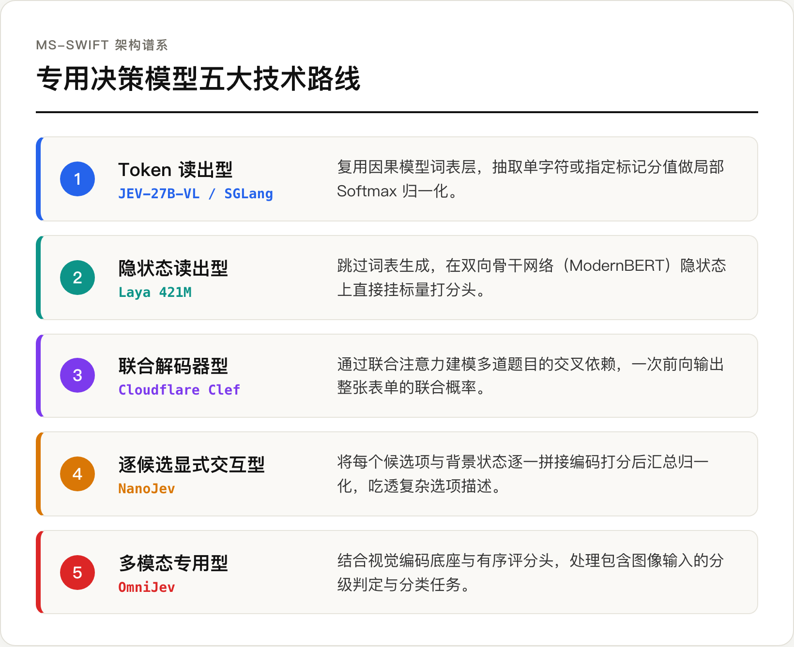
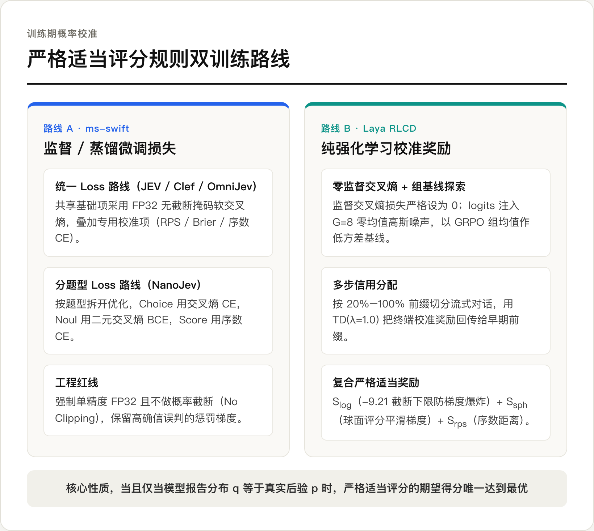
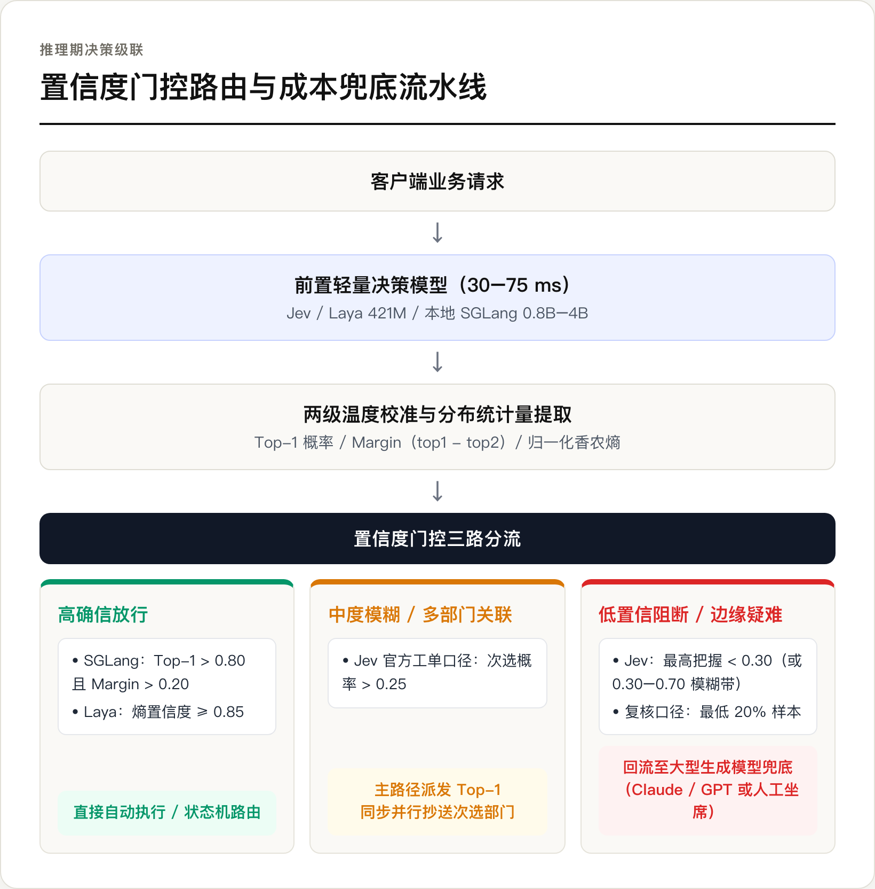

# 决策模型的概率校准、置信度级联与端侧平替账单

在上一篇《[给语言模型装一个动态分类头](/posts/给语言模型装一个动态分类头/)》里，我已经梳理过怎样砍掉大模型的自回归生成循环，用单次前向传播抽出候选标记的分值，或者像 Laya 那样靠双向编码器加动态 `[MASK]` 拼出一个三十多毫秒的分类头。

架构跑通之后，卡住生产落地的往往是后半截问题。业务代码拿到模型吐出来的 0.85，凭什么相信它在十次里真能蒙对八九次？如果各个候选选项需要横向比较，独立打分头会不会漏掉线索？线上把轻量决策模型和大型生成模型串成级联网关时，阈值卡在哪里最省钱？面对商业黑盒 API Jev，在本地拿开源小模型直接抽受限 logits 再配一层校准，到底能不能平替？

这篇对照几份开源框架文档与第三方独立审计数据，把这几笔数学账和工程账算清楚。

---

## 一、五大架构谱系与打破「盲审」的跨候选比对

随着 Jev、Laya 和 Cloudflare Clef 相继发布，魔搭社区的 ms-swift 团队把专用决策模型梳理成了五条技术路线。

五条路线的划分围绕信号来源与候选交互展开。**Token 读出型**（如 JEV-27B-VL、SGLang `/v1/score`）直接复用因果语言模型的词表层，抽出 `A`、`B`、`C` 或 `True`、`False` 单字符分值做局部归一化，挂个 LoRA 就能跑。**隐状态读出型**不走词表生成，直接在骨干网络隐状态上挂标量打分头，开源代表 Laya 就是用 ModernBERT 加 `[MASK]` 抽取向量打分。

其余三条路线则针对多问题和复杂输入。**联合解码器型**（如 Clef）用联合注意力层捕捉多道问题之间的交叉依赖，一次前向吐出整张表单的联合概率；**逐候选显式交互型**（如 `ms-swift` 定义下的 NanoJev）把每个候选项分别跟背景状态拼成完整序列、逐个编码打分再汇总归一化，能吃透复杂选项描述，代价是计算量随候选数线性上涨；**多模态专用型**（如 OmniJev）则把视觉编码器与有序评分头结合起来处理带图判定。

在这五类架构里，如果模型只是给每个选项接一个独立的线性头分别打分，各选项之间就相当于「盲审」。按照选择模型里的独立无关备选假设（IIA，Independence of Irrelevant Alternatives），往题目里新塞一个毫不相干的陪跑选项，原有选项之间的概率比值应该纹丝不动。但郝博阳在《一文拆解 Jev 架构》的黑盒测试里，给多选一（`Choice`）题目硬塞进一个无关干扰项「坏天气」后，原有选项之间的相对赔率发生了明显偏移。

这说明高阶决策模型内部存在让候选项同台比对的机制，目前开源社区拆解出了两种实现。**开源项目 `Kev` 采用指针头（Pointer Head）**，好比同场群面，模型把长背景和所有候选选项拼在同一条序列里单次通读，在序列末尾生成一个全局指针向量回头匹配各候选项隐状态。**`NanoJev` 则采用候选间注意力模块（Inter-candidate Attention Module）**，好比评委会讨论，各候选选项先各自抽出特征向量，再统一送进一层跨候选自注意力网络互相比较，把竞争选项本身也当成解题线索后再输出概率。

---

## 二、训练期校准（ms-swift 监督损失与 Laya RLCD 强化学习）

搭好跨候选交互结构之后，紧接着要解决深度学习的老毛病，过度自信（Overconfidence）。无论是卷积网络还是 Transformer，只要用常规硬标签交叉熵训练，模型就会把正确类别的 logits 往无穷大推。比如 Guo 等人在 2017 年经典校准论文中报告过，ResNet 在 CIFAR-100 上平均自报把握接近 90%，拉到测试集上实际准确率只有 70% 左右，虚高的数字没法直接写进业务代码的阈值判断里。

要让模型老实交代真实把握，数学上必须引入**严格适当评分规则（Strictly Proper Scoring Rules）**。设客观环境的真实分布为 $p$，模型报出的概率分布为 $q$，评分函数 $S(q, y)$ 衡量真实结果 $y$ 发生时的得分。当且仅当模型如实报告真实后验信念（$q = p$）时，期望得分才能达到唯一全局最优。

$$\mathbb{E}_{y \sim p}[S(p, y)] \ge \mathbb{E}_{y \sim p}[S(q, y)], \quad \forall q$$

围绕这条数学性质，工业界演化出了监督微调损失（`ms-swift`）与纯强化学习奖励（Laya RLCD）两条训练路线。

### 1. ms-swift 的监督与蒸馏微调损失谱系

ms-swift 支持两条支线。一条是 NanoJev 的分题型路线（多选一用交叉熵 CE、是非题用二元交叉熵 BCE、打分题用序数交叉熵）；另一条是 JEV、Clef 和 OmniJev 采用的统一损失路线，把目标拆成共享基础项加专用校准项。

共享基础项采用掩码软交叉熵（Log Score），在教师蒸馏软目标下等价于最小化 KL 散度。**ms-swift 在实现中定了一条工程红线，强制使用单精度（FP32）做掩码计算，并且在监督微调里不做概率截断（No Clipping）。** 一旦为了防溢出把极小概率截断，模型在做出高确信误判时就收不到足够陡峭的惩罚梯度，校准效果会大打折扣。

专用校准项则引入了有序概率得分（Rank Probability Score, RPS）与 Brier 得分。RPS 专门处理分级打分题（`Score`），计算预测累积分布函数（CDF）与真实累积分布在各档位上的距离平方和。

$$\text{RPS} = \sum_{m=1}^{K-1} \left( \sum_{k=1}^m q_k - \sum_{k=1}^m y_k \right)^2$$

把五星好评错判成一星差评，中间隔了四个累积阶梯，RPS 算出来的惩罚会比错判成四星重得多。ms-swift 把这些组件封装成了四套现成配方，分别是适配 JEV-27B-VL 的 `distill_rps`（教师蒸馏加 RPS）、适配 Clef 的 `smooth_brier`（标签平滑加 Brier）、适配 OmniJev 的 `ce_rps`（交叉熵加 RPS）以及基础纯评分模式 `scoring`。

### 2. Laya 的校准决策强化学习（RLCD）

**Laya 走的 RLCD 路线把监督式交叉熵损失直接设为零**，全程靠策略梯度优化三项严格适当评分组成的复合奖励。

第一项是对数评分 $S_{\text{log}}$。跟监督微调相反，强化学习的随机采样一旦抽中极低概率动作很容易炸穿策略梯度，所以 Laya 给对数评分设了 `-9.21` 的截断下限（对应概率下界约 $10^{-4}$）。为了弥补截断损失的边界梯度，它紧接着配上第二项球面评分（Spherical Score）。

$$S_{\text{sph}}(q, y) = \frac{q(y)}{\|q\|_2}$$

球面评分的梯度天然有界且平滑，刚好把对数评分在极小概率区的剧烈震荡抚平；第三项则同样挂上排序概率评分 $S_{\text{rps}}$ 约束序数打分。

训练时，Laya 对每个样本在评分头输出的 logits 上注入 $G = 8$ 组零均值高斯噪声 $\epsilon \sim \mathcal{N}(0, \sigma^2 I)$ 探索不同分布，用 GRPO 拿组内八次采样的均值当低方差基线。遇到长对话流式判断，它还会把上下文按 20% 到 100% 的前缀切成 5 个时间步，借用 $\text{TD}(\lambda = 1.0)$ 把最终水落石出时的校准奖励一路回传给早期前缀，逼着模型在信息不全的对话初期学会压低自信度。

---

## 三、推理期校准与两级温度标定下的置信度级联经济账

即便训练阶段用了适当评分规则，模型上线后遇到分布偏移（OOD）或不同题型混合调用，置信度还是会出现系统性漂移，需要在推理端补一道事后校准（Post-hoc Calibration）。

早期的 Platt 缩放是在独立校准集上冻结特征拟合逻辑回归（Sigmoid 映射），适合二分类，但样本太少容易把参数拟合歪。大模型推理更常用温度缩放（Temperature Scaling），拿单一正数温度 $T$ 缩放分值 $q_k = \frac{\exp(z_k / T)}{\sum \exp(z_j / T)}$。除以正数是严格单调变换，不会改变任何一题的准确率与选项排序，只把概率分布拉平或拉陡。

但 ms-swift 团队在实测中发现，同一个决策模型在不同原语题型上脾气截然相反，往往在是非题（`Noul`）上欠自信，到了打分题（`Score`）上又过自信。全模型共用一个温度，按下葫芦就会浮起瓢。**为此他们设计了两级温度标定（Two-Level Temperature Calibration），把实际生效温度拆成全局温度与题型相对温度连乘。**

$$\tau_{\text{effective}} = \tau_{\text{global}} \times \tau_{\text{task\_relative}}$$

先用全局温度 $\tau_{\text{global}}$ 把模型整体的冷热偏差拉回正轨，再乘上题型相对温度 $\tau_{\text{task\_relative}}$ 单独纠偏各题型。在样本外两折交叉验证里，这套两级标定把 JEV 的期望校准误差（ECE）从 0.00268 压到了 0.00143，降幅达 46.7%，Brier 得分也同步下降了 9.5%。

有了这套校准托底，把轻量决策模型放在前面当反射网关、大型生成模型放在后面兜底的置信度级联（Confidence Cascading）就可以量化算账了。

公开工程文章与框架报告给出了四组可直接对标的级联门控口径。

1. **本地 SGLang `/v1/score` 双阈值口径**（Avi Chawla「Build your own Jev (100% local)」），同时卡死最高项绝对概率 `top1 > 0.80` 与前两名胜出裕度 `Margin = top1 - top2 > 0.20`，双达标才毫秒级放行。
2. **Laya 归一化香农熵口径**（魔搭社区《Laya 开源》），按 $C = 1 - \frac{H(p)}{\log K}$ 计算把握。当卡死高阈值 $C \ge 0.85$ 时，Laya 自动处理 50% 的请求，子集准确率达 92.2%；放宽阈值吃下 80% 自动流量时，子集准确率依然稳在 89.4%，仅留 20% 疑难杂症交给后台。
3. **Jev 官方工单三层路由口径**（鸭哥《更好的替代品早已存在》引述），最高把握低于 `0.30`（或落在 `0.30` 到 `0.70` 模糊带）直接转人工；过线则派给第一名部门；只要**次选部门概率超过 `0.25`**，系统在派发主部门时会同步并行抄送（CC）次选部门一块跟进。
4. **韩美医学执照考试大模型复核账单**（魔搭社区《ms-swift 倾情奉献》引述 2026 年 10 月研究），评测 Jev、OpenAI Decisions 与 Clef 时发现，把模型把握最低的 20% 样本拎出来，里面集中抓到了全部错题的 56% 至 91%（韩文考题覆盖 56% 至 91%，英文考题覆盖 62% 至 72%）。**把最没底的 20% 样本定向送给大模型复核后，整体准确率提升 6 至 9 个百分点，整套系统的总算力开销只有全量调大模型的 25% 至 33%。**

---

## 四、云端黑盒与端侧平替的实证交锋

围绕「商业决策 API 到底有没有不可替代的护城河」，开源社区评测者与专用模型支持者给出了一组针锋相对的实测数据。

鸭哥（Yage）与何码先生在《[新模型 Jev 爆红一周](https://mp.weixin.qq.com/s/Ra3NBisCf95zFhlCbXZDZA)》中汇总了开源项目（`SemIf`、[jev-fire](https://github.com/kikoncuo/jevfire)、[truestandard.ai](https://truestandard.ai/blog/jev-accuracy-tested)）对 Jev 的独立审计，从四个维度对照云端黑盒与本地平替方案。

- **判断一致率**，在 102 项官方测试集的重构评估中，Jev 一致率为 88.3%，而 `SemIf` 基于冻结 Qwen3.5-4B 零微调直接抽首 token logits 的一致率为 84.5%，仅落后 3.8 个百分点。
- **校准误差（ECE）**，[truestandard.ai 评测](https://truestandard.ai/blog/jev-accuracy-tested)跨 6 领域 108 道命题的独立测试显示，Jev 的 ECE 为 0.066，与 Gemini 3.1 Flash Lite（0.061）、Claude Haiku 4.5（0.067）处于同一区间，业务方自己用 200 到 300 条样本做 Platt Scaling 或温度缩放即可拉平差距。
- **端到端延迟**，Jev 云端 API 中位延迟为 178 ms（Browser Use [jev-ultrafast](https://github.com/browser-use/jev-ultrafast) 实测），而 `jev-fire` 把 0.8B Qwen 放进浏览器用 WebGPU 本地运行每步只需 71.26 ms，Laya 421M 本地推理仅 33 到 38 ms。省掉公网往返时延（RTT，Round-Trip Time）后，端侧小模型比云端接口快两到五倍且边际调用成本接近零。
- **输出确定性**，Jev 官方自一致性操作手册的 15 次重复测试显示，同一输入在生产 API 上会在 `0.43` 到 `0.53` 之间摆动并横穿 0.5 决策临界点，主要源于云端动态批处理（Dynamic Batching）与非确定性 GPU 归约算子；本地固定权重直接读 logits 则能给出 100% 一致的确定性浮点结果。

不过，《一文拆解 Jev 架构》《Laya 开源》与《ms-swift 倾情奉献》也指出了「零微调抽现成因果模型首 token 加简单温度缩放」跨不过去的两道坎。

第一道坎是**教师蒸馏的主观偏见继承**。不少开源复刻拿大模型打软标签去蒸馏小模型，学生模型学到的只是教师模型的主观语言偏好（Subjective Belief），遇到教师模型常犯的盲目自信也会照单全收，反映不了客观世界的真实统计频率。

第二道坎是**事后温度缩放无法习得「无证据边界辨别力」**。在测试集上拧温度参数 $T$ 只能把整条自信度曲线统一压低或抬高，却教不会模型在证据缺失时主动退回 0.5 附近的最大熵状态承认「我不知道」。这种能力靠事后除常数除不出来，必须在训练期专门构造「证据不足（Insufficient Evidence）」对抗样本，配合严格适当评分规则或 RLCD 修改模型权重。

在浏览器智能体（Browser Agent）的提速归因上，鸭哥整理的消融对比还指出，前端感知表征清洗比更换末端判断模型的影响大得多。例如引入 WebMCP 把冗长杂乱的原始 DOM 树转成结构化工具契约后，**WindTunnel 基准任务完成率从 25/49 升到 49/49（100%），单步中位耗时从 5.4 秒降到 3.2 秒**；相反，如果前端喂进去的依然是脏乱 HTML，末端换再快的判断模型也救不回准确率。

---

## 五、生产落地的四条硬边界

把决策模型真正接进业务流水线之前，还有四条硬边界必须提前防住。

1. **严禁拿它硬做多步长程推理与算术题**。无自回归决策模型砍掉了逐词生成，也就拿走了思维链（CoT）暂存中间计算结果的草稿纸。据《一文拆解 Jev 架构》整理的 Archer Hume 黑盒实测，Jev 在 JevBench 困难推理题上的准确率只有 74.1%（DeepSeek V4.1 Flash 为 95.0%），换成两步算术应用题正确率直接跌到 32%。数值计算、日期比对和确定性规则检验一律交给原生代码，决策模型只干单步语义判定的活。
2. **防范位置呈现敏感性（Position Sensitivity）**。模型对关键事实摆在输入文本的哪个位置依然非常敏感。同一份架构拆解实验里，把同一条关键因果事实从文本开头挪到中间段落，判断正确率直接从 80.5% 腰斩到 40.9%。前置数据清洗管道应当把核心指标与关键事实统一提炼到 `State` 开头。
3. **警惕串联调用引发的延迟与成本倒挂**。决策模型省钱省时间的前提，是它能在前面直接拦住并消化五到八成的常规请求。如果业务规定不管前面判出什么结果，后面都得无条件再调一次大模型，那在前面串一道云端决策 API 纯属帮倒忙。上述拆解文章的实测记录显示，两者盲目串联后，Agent 端到端总延迟反而从 649 ms 暴涨到 1087 ms。
4. **候选集必须永远保留兜底选项**。无论业务分流多少个部门，受限候选列表里都应当显式保留 `OTHER` 或 `ESCALATE` 兜底项，防止范围之外的异常输入被闭集 Softmax 强行分摊给已有部门。

从架构、训练到级联账单，轻量决策模型能成立的前提一直很朴素。把复杂计算与兜底留给确定性代码和后置大模型，用干净的前端输入和诚实的置信度把八成常规流量挡在毫秒级门槛之内。

## 参考来源

1. 魔搭 ModelScope 社区（2026-10-26），《[ms-swift 倾情奉献，决策模型的从原理到上手定制](https://mp.weixin.qq.com/s/tXsB41r725D8iIX6K5nuCQ)》，代码仓库 [modelscope/ms-swift](https://github.com/modelscope/ms-swift)
2. 魔搭 ModelScope 社区（2026-09-21），《[Laya 开源，比 Jev 快 4 倍！421M 参数，33 毫秒完成 System 1 决策](https://mp.weixin.qq.com/s/9SJf3nhK25rZcZwQNTg7mw)》，代码仓库 [NandhaKishorM/laya](https://github.com/NandhaKishorM/laya)
3. 郝博阳（腾讯云开发者，2026-10-14），《[一文拆解 Jev 架构，一个判断模型是怎么被拼出来的](https://mp.weixin.qq.com/s/E1fvA95qGkEnKinTAACWaA)》
4. 鸭哥 Yage（2026-09-19），《[更好的替代品早已存在，Jev 留给研究的只剩时机](https://yage.ai/share/jev-timing-analysis-20260919.html)》
5. Avi Chawla（Daily Dose of DS，2026-09-22），「[Build your own Jev (100% local)](https://www.dailydoseofds.com/ai-agents-with-langgraph-course-part-1-with-implementation/)」
6. 何码先生（代码的使命，2026-09-19），《[新模型 Jev 爆红一周，不生成文字、只输出概率，却被玩出了花](https://mp.weixin.qq.com/s/Ra3NBisCf95zFhlCbXZDZA)》
7. truestandard.ai，[Jev Accuracy Tested](https://truestandard.ai/blog/jev-accuracy-tested)（跨 6 领域 108 题校准误差独立评测）
8. Browser Use，[browser-use/jev-ultrafast](https://github.com/browser-use/jev-ultrafast)（航旅查询 178 ms 实测仓库）
9. kikoncuo，[kikoncuo/jevfire](https://github.com/kikoncuo/jevfire)（`jev-fire` 浏览器端 WebGPU 0.8B 复现仓库）
10. Chuan Guo et al. (ICML 2017), *On Calibration of Modern Neural Networks*
