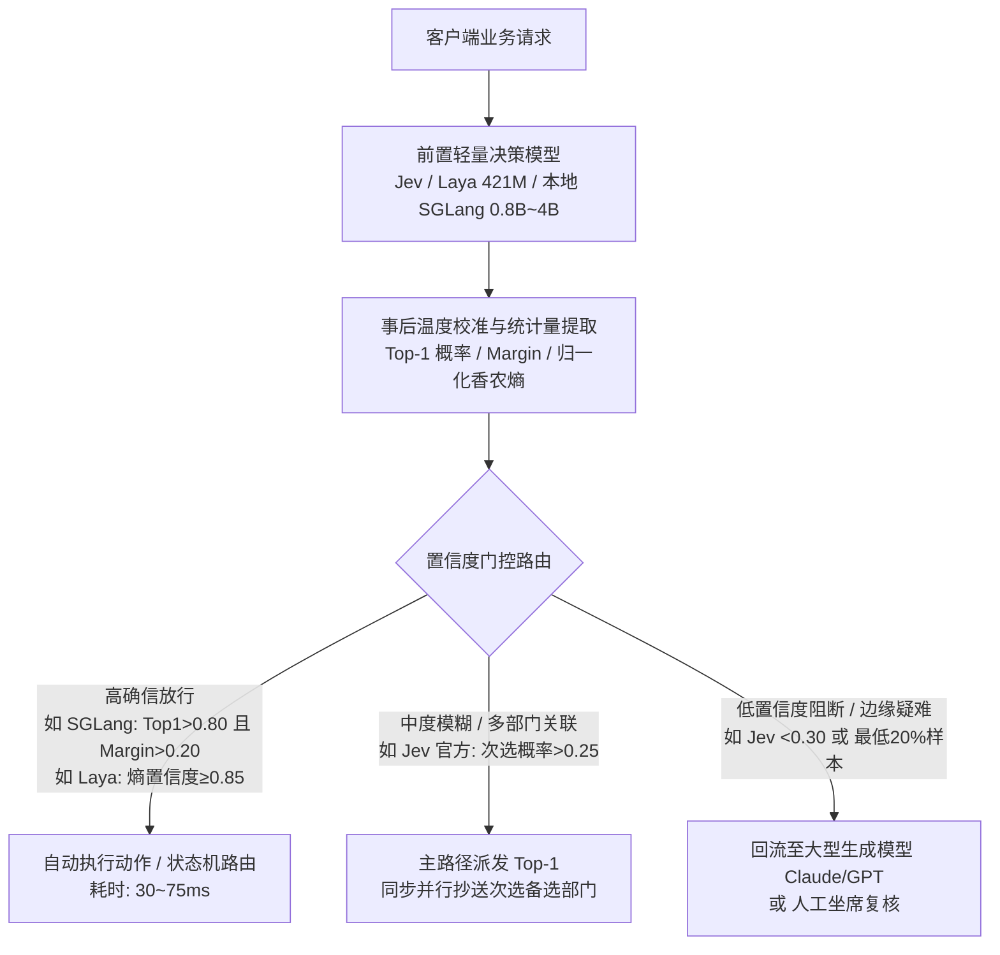

# 综述：专用决策模型架构与置信度校准全景

## 1. 核心结论 (Executive Summary)

1. **范式跃迁（从自回归生成到确定性概率判断）**：在现代智能体（AI Agent）系统的执行循环中，绝大多数高频中间调用并非开放式文本创作，而是属于工单路由、安全拦截、工具选择与状态机流转等反射式决策任务 `[多源一致]`。传统让通用大模型生成自由文本或通过 JSON Schema 结构化解码的做法，存在数百毫秒至秒级延迟、昂贵 Token 成本与格式幻觉等固有缺陷；**专用决策模型（System 1 Decision Model）**通过无自回归单次前向直接输出受限候选集合的归一化概率分布，将单步判断耗时压缩至 30~100 毫秒，且先验杜绝 Schema 格式解析错误。
2. **统计基石（严格适当评分规则与两级温度标定）**：现代深度神经网络因过度追求硬标签分类，普遍存在严重的过度自信（Overconfidence）问题（如 ResNet 在 CIFAR-100 上平均置信度高达 90% 但实测准确率仅约 70%）`[多源一致]`。决策模型在监督/蒸馏微调中采用**严格适当评分规则（Strictly Proper Scoring Rules）**（无截断掩码软交叉熵、有序概率得分 RPS、Brier 得分），或在强化学习中采用 **RLCD（复合对数评分、球面评分与 RPS 奖励）**，使模型在报告真实后验概率时达到全局最优；结合**全局与题型相对的两级温度标定（Two-Level Temperature Calibration）**，实测可使期望校准误差（ECE）降低 46.7%，让预测置信度成为具备统计学真实频率意义的程序控制门控量。
3. **工程落地架构（置信度级联、端侧平替与帕累托最优）**：决策模型无法取代具备深度认知推理的生成大模型，其最佳工业定位是作为**置信度级联（Confidence Cascading）**的前置反射门控层。在医学执照考试等跨模型实测中，置信度最低的 20% 样本覆盖了 56%~91% 的潜在错误，将其定向回流至大型生成模型复核可使准确率提升 6~9 个百分点，而系统总成本仅为全量大模型方案的 25%~33%；同时，对于延迟敏感与数据隐私场景，利用开源小模型（如 0.8B~4B Qwen）或 421M 专用编码器（Laya）在端侧直接提取受限 Logits 并配合轻量事后校准，能够以零 API 成本与完全确定性输出逼近甚至超越商业黑盒云服务 `[来源分歧]`。

---

## 2. 技术全景 / 体系框架

### 2.1 范式演进：传统分类 vs 生成式解码 vs 专用决策模型

智能体落地面临的核心矛盾在于：高频的“判断需求”与重型的“生成计算”严重错配。在工业界过去十年的演进中，分类判断与文本生成经历了五轮循环：

```
[2017 Perspective API] ──► [2021 OpenAI /classifications] ──► [2022 Cohere Classify]
  (固定类目安全审核)               (少样本端点，后因生成更灵活被弃)           (依赖旧嵌入模型，半退役)
                                                                            │
┌───────────────────────────────────────────────────────────────────────────┘
▼
[2025 GLiNER2] ────────► [2026 Jev / Laya / ms-swift]
  (零样本实体抽取，受限512Token)    (System 1 专用决策模型爆发，无自回归、全校准概率、毫秒级响应)
```

在底层计算机制上，三种输出范式呈现出本质差异：

| 评估维度 | 传统判别式分类器 | 生成式大模型 (含结构化输出) | 专用决策模型 (Decision Model) |
| :--- | :--- | :--- | :--- |
| **底层推理行为** | 固定分类头单次前向 | 逐 Token 自回归循环解码文本/JSON | **单次前向传播直接提取 Logits，零自回归生成** |
| **首字 / 首包时间** | 数十毫秒 | 几百至数千毫秒（受解码长度与网络约束） | **30～100 毫秒（仅单次 Prefill 耗时）** |
| **输出信息形态** | 单一硬标签（Argmax） | 自由文本或 JSON 字符串（需正则解析） | **全候选项归一化校准概率分布 + Margin 置信度** |
| **零样本泛化能力** | 极弱（类别固定，新增标签需重训） | 极强（Prompt 灵活指定候选与场景） | **极强（支持运行时动态指定任意候选集合与上下文）** |
| **格式幻觉风险** | 0% | 存在非法字段、括号未闭合或枚举外取值风险 | **0%（先验 Schema Matching 约束，杜绝解析崩溃）** |
| **置信度可信度** | 存在未校准偏差 | 严重过度自信（置信度常饱和于 1.0） | **严格校准（ECE 极低，概率如实反映统计频率）** |
| **典型适用场景** | 静态标签且样本充足的特定任务 | 开放式创作、复杂规划与多步认知推理 | **Agent 状态机路由、命令安全拦截、工单分流与工具门控** |

> **选型黄金法则**：*“当输出内容在推理前未知时，使用生成式 LLM；当合规选项集合在推理前已知且有限时，使用决策模型做概率打分。”*

---

### 2.2 接口形态与交互原语（Primitives）

以 TypeSafe [[entities/实体_Jev|Jev]] 与开源 [[entities/实体_Laya|Laya]] 为代表的现代决策模型，抽象出高度标准化的声明式契约：
- **`State`（状态）**：共享的长篇背景材料（用户请求、客服历史日志、系统环境信息）。
- **`Questions`（问题列表）**：针对该 `State` 提出的若干独立判断问题，各问题在执行期互不干扰。

#### 三大标准化原语
1. **`Noul`（是非命题判断）**：输入陈述命题，直接返回单标量校准概率 $P(\text{true}) \in [0.0, 1.0]$。
2. **`Choice`（多选一离散分类）**：输入预设候选集合，直接输出每个选项的归一化概率分布向量及整体决策把握裕度（Margin）。
3. **`Score`（有序量表分级打分）**：输入分级等级（如 2~10 档），输出各档位的离散概率分布以及加权期望分。

#### 推测性并发（Speculative Fan-out）与行动头（Act Head）
- **推测性并发**：支持在入口处针对同一份 `State` 一次性并发提出多达数十至 250 道独立问题（如“用户是否愤怒”、“是否涉及退款”、“分派哪一团队”）。由于底层机制高度复用，百道题目并发耗时几乎不随题量线性增长，由下游业务代码按逻辑短路剪枝。
- **成本敏感型行动/升级头（Act / Escalate Head）**：Laya 引入了专用的决策动作头，将池化隐向量与 4 维分布统计量（最高概率、Top1 与 Top2 边际差、归一化香农熵、选项预算比）拼接。根据企业业务成本矩阵（正确收益 $+1.0$、错误代价 $-3.0$、转人工成本 $-0.5$），数学推导证明**仅当置信度高于 62.5% 时自主执行动作才具备正期望**，低于该阈值则触发平滑转人工（Escalate）。

---

### 2.3 决策模型的五大架构流派与候选交互机制

在工业界与开源社区实现专用决策模型时，[[entities/实体_ms-swift|ms-swift]] 总结了五大架构流派（结合跨源代表模型 [[entities/实体_Laya|Laya]] 与 `Kev` 的反向工程拆解归纳如下）：

```
                              [专用决策模型架构谱系]
                                        │
     ┌──────────────────┬───────────────┼───────────────┬──────────────────┐
     ▼                  ▼               ▼               ▼                  ▼
[Token 读出型]    [隐状态读出型]  [联合解码器型]  [逐候选显式交互型]  [多模态专用型]
(如 JEV-27B-VL)   (如 Laya 421M)   (如 Clef)       (如 NanoJev)       (如 OmniJev)
输出层读 Verbalizer 骨干网络加打分头 联合注意力建模  候选与状态拼接编码  视觉底座结合有序头
微调迁移极简       极轻量超低延迟   适合表单批量审计 细粒度但算量随候选涨 跨模态反射决策
```

1. **Token 读出型（Verbalizer-based Token Reading）**：
   - *代表*：JEV-27B-VL、SGLang `/v1/score`。
   - *机制*：保留因果语言模型的输出层（LM Head），在输出分布上按固定单 Token（如 `A`、`B`、`C` 或 `True`、`False`）提取 Logits 并执行受限 Softmax。几乎不增加新参数，天然支持 [[concepts/概念_LoRA_低秩适应微调|LoRA]] 微调与主流 Serving 框架部署。
2. **隐状态读出型（Hidden-State Scorer）**：
   - *代表*：`ms-swift` 标量打分头模式；跨源代表为 [[entities/实体_Laya|Laya]]（421M 基于 ModernBERT-large）。
   - *机制*：不依赖词表层生成，直接对骨干网络隐状态附加标量打分头。以跨源实例 Laya 为例，通过在输入序列中为每个候选选项注入动态 `[MASK]` Token，经由双向编码器与两层决策头 Transformer（Decision Head）后，使用 `torch.gather` 抽取对应标记向量，再经轻量 MLP 评分器输出 Logits，GPU 单次前向仅需 33～38 毫秒。
3. **联合解码器型（Joint Decoder）**：
   - *代表*：Cloudflare Clef。
   - *机制*：使用专用联合注意力层建模多问题间的交叉依赖，单次前向输出整套问题的联合概率分布，非常适配结构化清单审计与表单批量填充。
4. **逐候选显式交互型（Explicit Per-candidate Encoding）**：
   - *代表*：NanoJev。
   - *机制*：在 `ms-swift` 定义中，将每个候选选项分别与上下文 `State` 拼接后独立送入模型编码打分，最后对所有候选得分统一做归一化。优点是支持任意长度复杂选项描述，缺点是计算量随候选数量线性增长。
5. **多模态专用型（Multimodal Decision Model）**：
   - *代表*：OmniJev。
   - *机制*：直接整合视觉/视频编码底座与有序评分头，实现跨多模态的高精度反射决策。

#### 打破“独立线性头盲审”：两种跨候选横向比对机制
在《一文拆解 Jev 架构》的黑盒探测中发现，向 `Choice` 题插入无关干扰项会改变原有选项间的相对赔率（违反独立无关备选假设 IIA），证明高阶决策模型并非让各选项“独立盲审”，而是具备横向比对机制：
- **机制一：指针头架构（Pointer Head，代表项目：`Kev`）——“同场群面”**：将背景与所有候选选项一次性拼入同一序列单次通读，在序列末尾特定位置生成全局指针向量，直接指回前文各个候选选项对应的隐状态计算匹配度打分。
- **机制二：候选间注意力模块（Inter-candidate Attention Module，代表项目：`NanoJev`）——“评委会讨论”**：各候选选项先分别抽取特征表示向量，随后汇总送入一层专用的跨候选自注意力（Self-Attention）网络进行横向交互与拉踩比对，最后输出归一化概率。

#### 底层加速基石：状态共享与题目物理隔离
- **KV Cache 冻结共享**：面对长背景 `State`，系统仅执行一次 Prefill 计算，将其 Key/Value 状态冻结在 [[concepts/概念_KV_Cache_键值缓存|KV Cache]] 中，后续所有并发题目直接复用该缓存，消除冗余计算。
- **题目隔离**：通过**注意力掩码（Attention Masking）**强行置零相邻题目间的注意力权重，或通过**分叉缓存（Forking KV Cache）**分化独立推导分支，实现完全的物理隔离。

---

### 2.4 统计优化与损失函数谱系：监督微调 vs RLCD 强化学习

现代神经网络（如深度卷积网与通用 Transformer）在常规硬标签交叉熵训练下，普遍存在严重的**过度自信（Overconfidence）**现象（例如 ResNet 在 CIFAR-100 上平均预测置信度达 90%，但实测准确率仅 70%）。朴素交叉熵驱动模型输出极端极化的 Logits，破坏了预测置信度与真实发生频率的一致性。

#### 适当评分规则（Proper Scoring Rules）数学原理
设环境真实结果分布为 $p$，模型报告的概率分布为 $q$。评分规则 $S(q, y)$ 衡量报告分布 $q$ 在实际发生标签 $y$ 下的得分。当且仅当模型诚实报告自身真实后验信念时，期望得分达到全局最大（或损失达到全局最小）：
$$\mathbb{E}_{y \sim p}[S(p, y)] \ge \mathbb{E}_{y \sim p}[S(q, y)], \quad \forall q$$
若等号成立当且仅当 $q = p$，则该规则被称为**严格适当的（Strictly Proper）**。

在具体训练实现上，工业界分化出**监督/蒸馏微调损失谱系（以 `ms-swift` 为代表）**与**纯强化学习复合奖励谱系（以 `Laya RLCD` 为代表）**两条路径：

```
                         [严格适当评分规则训练双路线]
                                      │
          ┌───────────────────────────┴───────────────────────────┐
          ▼                                                       ▼
[路线 A：监督/蒸馏微调损失 (ms-swift)]               [路线 B：纯强化学习奖励 (Laya RLCD)]
  ├─ 统一 Loss 路线 (JEV / Clef / OmniJev)：          ├─ 监督交叉熵损失严格设为 0
  │    共享基础项 (FP32 无截断掩码软交叉熵)            ├─ 策略探索：G=8 零均值高斯噪声采样 + GRPO 组均值基线
  │    + 专用校准项 (RPS / Brier / 序数 CE)          ├─ 信用分配：TD(λ=1.0) 前缀切分多步轨迹传递
  └─ 分题型 Loss 路线 (NanoJev)：                     └─ 复合严格适当奖励：
       Choice 用 CE / Noul 用 BCE / Score 用序数 CE        S_log (带 -9.21 截断下限) + S_sph (球面评分) + S_rps
```

#### 路线 A：监督与蒸馏微调损失谱系（ms-swift）
[[entities/实体_ms-swift|ms-swift]] 提供了**统一 Loss 路线**与**分题型 Loss 路线**（如 NanoJev 对多选一用交叉熵 CE、对是非题用二元交叉熵 BCE、对分级打分用序数交叉熵）。其中统一 Loss 路线将损失函数抽象为**“共享基础项 + 专用校准项”**：
1. **掩码软交叉熵（Masked Soft Cross-Entropy / Log Score）**：
   - 数学形式为对数评分 $S_{log} = \log q(y)$。在硬标签下退化为标准交叉熵，在教师蒸馏软目标下等价于最小化 KL 散度。
   - **工程实现要点**：采用全单精度（FP32）掩码计算，且**在监督微调中绝对不进行概率截断（No Clipping）**，确保在预测发生严重高确信错误时，反向传播依然能获取陡峭的惩罚梯度。
2. **有序概率得分（Rank Probability Score, RPS）**：
   - 专用于有序分级打分题（Score Primitives），计算预测累积分布函数（CDF）与真实累积分布函数在各档位上的距离平方和：
     $$\text{RPS} = \sum_{m=1}^{K-1} \left( \sum_{k=1}^m q_k - \sum_{k=1}^m y_k \right)^2$$
   - 能够有效惩罚跨档位的严重离谱误判（如将 5 星误判为 1 星的惩罚远大于误判为 4 星）。
3. **Brier 得分（Brier Score）**：衡量预测概率向量与真实目标向量间的均方欧氏距离 $\frac{1}{K}\sum_{k=1}^K (q_k - y_k)^2$。
4. **ms-swift 四种预设损失组合**：
   - `distill_rps`：教师蒸馏软目标 + 有序概率得分（适配 JEV-27B-VL）；
   - `smooth_brier`：标签平滑交叉熵 + 均方 Brier 得分（适配 Clef）；
   - `ce_rps`：纯对数得分 + RPS（适配 OmniJev）；
   - `scoring`：基准纯评分模式。

#### 路线 B：校准决策强化学习谱系（Laya RLCD）
[[entities/实体_Laya|Laya]] 提出的 [[concepts/概念_RLCD校准决策强化学习|RLCD（Reinforcement Learning for Calibrated Decisions）]] **完全摒弃了监督式交叉熵损失（设为零）**，直接基于策略梯度优化三项严格适当评分规则构成的复合奖励：
1. **对数评分（Logarithmic Score, $S_{log}$）**：提供陡峭的梯度信号；为防止策略梯度采样中低概率动作导致数值爆炸，**专门设置了 `-9.21` 的截断下限**（对应概率下界约 $10^{-4}$，此处与 `ms-swift` 监督微调“不截断”形成机制对比）。
2. **球面评分（Spherical Score, $S_{sph}$）**：数学定义为 $S_{sph}(q, y) = \frac{q(y)}{\|q\|_2}$。其梯度有界且平滑，专门用于中和对数评分在极小概率区域的梯度尖峰，保障强化学习训练稳定。
3. **排序概率评分（RPS, $S_{rps}$）**：赋予 `Score` 量表题天然的序数距离感知。
4. **GRPO 组噪声探索与 $TD(\lambda=1.0)$ 信用分配**：对每个训练样本，在评分头输出 Logits 上注入 $G=8$ 组零均值高斯噪声 $\epsilon \sim \mathcal{N}(0, \sigma^2 I)$ 进行探索，采用 GRPO（组相对策略优化）以组内均值作为低方差基线；针对长链条流式状态，将对话按 $20\% \sim 100\%$ 前缀切分为 5 个时间步，通过 $TD(\lambda=1.0)$ 将最终决策的校准奖励回传至早期前缀状态。

---

### 2.5 置信度校准工程与级联落地架构

即便通过适当评分规则训练，在面对分布偏移（OOD）或不同题型时，模型仍会存在系统性置信度偏差。因此必须引入事后校准（Post-hoc Calibration）工程。

#### 校准方法横向比较
- **Platt 缩放（Platt Scaling）**：在独立保留的验证集（Calibration Set）上以冻结特征训练逻辑回归（Sigmoid 映射），将原始打分拟合为校准概率。该方法对小样本高度敏感，样本过少易导致拟合参数失真。
- **温度缩放（Temperature Scaling）**：采用单一标量温度参数 $T > 0$ 缩放 Logits：$q_k = \frac{\exp(z_k / T)}{\sum \exp(z_j / T)}$。由于 $T$ 是严格单调变换，分类准确率与预测排序严格不变，仅调整分布平滑度。
- **两级温度标定机制（Two-Level Temperature Calibration）**：
  - 由 [[entities/实体_ms-swift|ms-swift]] 框架率先提出，针对决策模型在不同题型上呈现出“是非题欠自信、打分题过自信”的系统偏差，采用级联相乘温度：
    $$\tau_{effective} = \tau_{global} \times \tau_{task\_relative}$$
  - **全局温度 $\tau_{global}$** 纠正整体偏差，**题型相对温度 $\tau_{task\_relative}$** 纠正题型特异偏差。通过样本外两折交叉验证拟合，实测使 Jev 模型的**期望校准误差（ECE）从 0.00268 降至 0.00143，降幅达 46.7%**，Brier 得分下降 9.5%。

#### 置信度级联（Confidence Cascading）生产架构与多源实证口径

在智能体工业落地中，将轻量决策模型与大型生成模型/人工复核组合部署，是实现高吞吐、低延迟与高精度的核心范式。不同文献从各自评测口径验证了这一级联机制：



各文献的具体门控阈值与实测收益对照如下（注意区分各自实验主体与指标口径）：
1. **本地 SGLang `/v1/score` 雙阈值门控口径（出自《Build your own Jev》）**：
   - 同时检查**最高项绝对概率（`top1 > 0.80`）**与**第一、二名胜出裕度（`Margin = top1 - top2 > 0.20`）**。达标则毫秒级放行，否则判定为模棱两可转交人工或大模型。
2. **Laya 归一化香农熵级联口径（出自《Laya 开源白皮书》）**：
   - 定义基于归一化香农熵的置信度指标 $C = 1 - \frac{H(p)}{\log K}$：
     - 当阈值设为 **$C \ge 0.85$** 时，系统可**自动处理约 50% 的请求，子集准确率达 92.2%**；
     - 当放宽阈值以覆盖 **80% 的自动处理请求**时，**子集准确率仍保持在 89.4%**，剩余 20% 疑难样本交由大模型兜底。
3. **Jev 官方工单三层路由口径（出自《更好的替代品早已存在》引述）**：
   - **拦截层**：最高置信度 `< 0.30`（或落入 `0.30~0.70` 模糊带）直接拒绝自动路由并转交人工；
   - **主派发层**：超过阈值则自动派发给 Top-1 部门；
   - **并行抄送层**：若**第二名备选概率 `> 0.25`**，系统在派发主部门的同时**同步并行抄送（CC）**备选部门协同处理。
4. **韩美医学执照考试大模型复核经济账（出自《ms-swift》引述的 2026-10 研究）**：
   - 在针对 Jev、OpenAI Decisions 与 Clef 的医学执照考试评测中，**模型置信度最低的 20% 样本集中覆盖了全部错题的 56%～91%**（其中韩文数据集覆盖 **56%～91%** 错误，英文数据集覆盖 **62%～72%** 错误）。
   - 仅将这最低置信度的 20% 样本定向交由大型生成模型复核，整体准确率即可提升 **6～9 个百分点**，而**系统总算力成本仅为全量调用大模型方案的 25%～33%**。

---

### 2.6 跨源交锋：端侧 Logits 平替实证与“校准护城河”之争 `[来源分歧]`

围绕“商业黑盒决策 API（如 Jev）是否具备不可替代的技术护城河”，库内文献呈现出鲜明的正反方实证交锋：

#### 1. 云端商业 API（Jev）vs 本地开源小模型直接提取 Logits 的四维实测对比
[[entities/实体_鸭哥|鸭哥]]与何码先生汇总了开源社区（`SemIf`、`jev-fire`、`truestandard.ai`）对 Jev 的独立审计，从准确率、校准度、延迟与确定性四个维度提出了有力挑战：

| 评测维度 | 商业云服务 Jev | 开源端侧 / 本地平替方案 | 核心实证结论 |
| :--- | :--- | :--- | :--- |
| **判断一致率** | **88.3%**（102 项官方测试集） | **84.5%**（`SemIf`：冻结 Qwen3.5-4B，零微调直接抽首 Token Logits） | 零训练现成 4B 小模型仅落后 Jev **3.8 个百分点**。 |
| **校准误差 (ECE)** | **0.066**（`truestandard.ai` 跨 6 领域 108 命题） | Gemini 3.1 Flash Lite (**0.061**)、Claude Haiku 4.5 (**0.067**) | 通用轻量模型配合 200~300 条样本做 Platt Scaling / 温度缩放即可拉平 ECE。 |
| **端到端延迟** | 云端中位延迟 **178 ms** | **`jev-fire`**：0.8B Qwen 经 WebGPU 在浏览器本地运行仅 **71.26 ms**；[[entities/实体_Laya|Laya]] 421M 仅 **33~38 ms** | 省去公网 RTT 后，端侧亚十亿级小模型比云端 API 快 2~5 倍且零调用费。 |
| **输出确定性** | **存在随机抖动**（同一输入连测 15 次，概率在 `0.43~0.53` 摆动，横穿 0.5 阈值） | **100% 确定性输出**（本地固定权重与算子，同输入永远给出完全一致的浮点数） | 云端动态批处理（Dynamic Batching）与非确定性 GPU 归约算子导致边界摆动，对合规审计构成隐患。 |

#### 2. 关于“概率校准是否构成核心壁垒”的 `[来源分歧]`
- **反方观点（鸭哥《更好的替代品早已存在》/ 何码先生）**：认为 Jev 的定式（单次前向抽候选 Token Logits + 局部归一化 + 事后校准）在 LLM 推理工程中早已成熟（如 SGLang `/v1/score`）。所谓校准优势，开发者仅需收集 200~300 条业务标注样本，用几行代码跑一次温度缩放或 Platt Scaling 即可在本地复刻，Jev 留给研究的更多是商业包装与切入时机。
- **正方/审慎观点（《一文拆解 Jev 架构》/《Laya 开源》/《ms-swift》）**：指出简单抽取因果 LLM 首 Token 存在三大隐蔽天花板：
  1. **分词器陷阱与因果掩码限制**：多字符选项首 Token 共享前缀会导致概率塌缩，且因果注意力（Causal Mask）使选项无法像双向编码器（ModernBERT）那样充分互看；
  2. **教师蒸馏的“主观偏见继承”**：开源复刻常用的“大模型打软标签 + LoRA 蒸馏”，学到的只是教师模型的**主观语言偏好（Subjective Belief）**，而非真实世界的客观经验频率；
  3. **事后温度缩放的局限性**：单纯的温度缩放只能全局压低或抬高自信度曲线，**无法赋予模型在缺乏证据时主动识别“我不知道”（输出 0.5 最大熵状态）的边界辨别力**——后者必须依赖训练期专门构造的“证据不足（Insufficient Evidence）”对抗样本与严格适当评分规则（或 RLCD）联合塑造。

#### 3. GUI / Browser Agent 端到端提速的真实归因
在浏览器智能体评测中，社区曾将任务提速笼统归功于引入了 Jev 决策模型。但 [[entities/实体_鸭哥|鸭哥]] 通过消融对比指出：**端到端性能跃升的头号功臣是前端感知表征的结构化清洗，而非判断模型本身**——例如引入 [[concepts/概念_WebMCP_浏览器原生工具协议|WebMCP]] 将冗长杂乱的原始 DOM 树转化为干净的结构化工具契约后，仅凭前端降噪就将任务完成率从 **25/49 提升至 49/49（100%）**，单步耗时从 **5.4 秒压缩至 3.2 秒**。若输入感知层依然喂入脏乱 HTML，单靠末端换用决策模型无法挽救准确率。

---

### 2.7 适用边界、工程避坑与经济账

专用决策模型并非万能药，在系统集成中必须严格防范以下边界陷阱：

1. **两大约束硬伤**：
   - **困难多步长程推理失真**：多条件逻辑、连续证据查找、跨步状态传递及算术计算是无自回归决策模型的严重短板（因其缺乏思维链 CoT 的中间计算暂存区）。评测表明，Jev 在困难推理题上的准确率显著落后于通用大模型（**74.1% vs 95.0%**），在两步算术应用题上正确率甚至骤降至 **32%**。**规避法则**：数值计算、日期比对与确定性逻辑一律由原生代码处理，决策模型仅负责单步语义判定。
   - **位置呈现敏感性（Position Sensitivity）**：模型对输入文本中关键关系的呈现位置高度敏感。实验表明，当关键因果事实从文本开头移至中间段落时，判断正确率可能从 **80.5% 腰斩至 40.9%**。必须在前置数据清洗时保证关键事实结构化前置。
2. **受限 Softmax 的逃逸通道（Escape Route）**：
   - 当现实输入无法被预设选项穷尽时（如安全警报误入普通工单路由），受限 Softmax 仍会强行将 100% 概率分摊给已知选项。**因此预设候选集中必须显式包含 `OTHER` 或 `ESCALATE` 作为安全兜底**。
3. **警惕端到端延迟与成本倒挂**：
   - 决策模型的价值在于**前置拦截与短路分流**。如果在业务调用大型生成模型之前，盲目串联一道云端决策模型做“双重把关”且后续大模型依然无条件调用，不仅无法提速，还会因增加一次网络与模型调用导致 Agent 端到端总延迟从 **649ms 激增至 1087ms**，成本不降反升。

---

## 3. 关联概念与实体图谱

### 关联核心概念
- [[concepts/概念_Decision_Model_专用判断模型]]：从生成中解耦的选项判断与概率输出核心模型形态。
- [[concepts/概念_分类模型校准]]：Platt Scaling、温度缩放与两级温度标定算法体系。
- [[concepts/概念_RLCD校准决策强化学习]]：基于严格适当评分规则与策略梯度的强化学习决策范式。
- [[concepts/概念_KV_Cache_键值缓存]]：共享 State 单次 Prefill 冻结与题目并发复用的计算缓存基础。
- [[concepts/概念_LoRA_低秩适应微调]]：通过轻量 Adapter 实现 `generic_decision` 模型架构转换。
- [[concepts/概念_LLM模型路由]]：基于分类置信度实现请求动态分流与降级。
- [[concepts/概念_连续批处理]]：推理服务端并发调度固定候选项打分请求的核心技术。
- [[concepts/概念_WebMCP_浏览器原生工具协议]]：UI 自动化中前端结构化感知与轻量决策解耦的代表协议。

### 关联关键实体
- [[entities/实体_ms-swift]]：开源微调推理框架，首创决策模型全流程支持、专属 loss 谱系与两级温度标定。
- [[entities/实体_Laya]]：Convai 开源的 421M 参数、33ms 延迟、基于 ModernBERT 与 RLCD 的 System 1 决策模型。
- [[entities/实体_Jev]]：TypeSafe 发布的商业化无生成概率判断模型服务。
- [[entities/实体_OpenAI]]：早期探索 `/classifications` 端点，2026 年推出 OpenAI Decisions 首 Token 截取接口。
- [[entities/实体_Claude_Code]] / [[entities/实体_Codex]]：在高频 Shell 命令执行前深度依赖前置安全分类与状态判断的编码智能体。
- [[entities/实体_LangChain]]：基于决策模型构建前置安全拦截与轻量路由中间件。
- [[entities/实体_鸭哥]]：系统剖析判断 API 五轮演进浪潮与端侧 Logits 提取架构分析的作者。

---

## 4. 待验证问题与未来演进方向

1. **超长上下文下的校准保真度**：当背景材料 `State` 从千级 Token 扩展至 64k~128k（如完整代码仓库或复杂法律卷宗）时，两级温度标定与 RLCD 机制能否依然保持低 ECE？长距离注意力衰减是否会导致特定题型校准失效？
2. **端到端隔离消融基准的统一**：当前开源社区在比较 Jev、Laya 与开源模型（如 Qwen3.5-4B 提取 Logits）时，多存在输入表征清洗程度不同的变量干扰。亟需建立在统一严格感知表征输入下的标准化 Decision Benchmark。
3. **自适应无显式标签的 OOD 逃逸检测**：当前必须依赖人工预设 `OTHER` 标签来防范未穷尽风险。未来能否通过 Logits 能量函数（Energy-based OOD Detection）或隐藏层表征距离，实现无需选项硬编码的自适应分布外逃逸？
4. **思考模型（System 2）对决策模型（System 1）的自进化反哺**：随着深度思考模型（如 o1、DeepSeek-R1）普及，如何利用具备长思维链验证能力的慢思考模型，自动化合成高质量对抗样本，闭环蒸馏出更强、更抗位置呈现扰动的端侧 System 1 决策模型？

---

## 5. 支撑来源树

- **工业实践与开源框架**：
  - [[wiki/sources/ms-swift倾情奉献_决策模型从原理到上手定制.md]] — 魔搭社区 ms-swift 决策模型架构、专属 loss 与两级温度标定实录
  - [[wiki/sources/Laya开源_421M参数33毫秒System1决策.md]] — Convai 开源 421M ModernBERT + RLCD 决策模型白皮书
- **商业模型解密与架构反向工程**：
  - [[wiki/sources/一文拆解Jev架构_一个判断模型是怎么被拼出来的.md]] — 腾讯云开发者反向解密 Jev 原语、KV Cache 冻结与指针头机制
  - [[wiki/sources/新模型Jev_爆红一周_不生成文字只输出概率却被玩出了花.md]] — TypeSafe Jev 爆红复盘、Schema 约束与 Agent 判断负载分析
- **本地复现与工程范式比较**：
  - [[wiki/sources/更好的替代品早已存在，Jev 留给研究的只剩时机.md]] — 鸭哥评 Jev 时机与判断 API 五轮浪潮，对比端侧 Logits 提取
  - [[wiki/sources/2026-09-22_Build-your-own-Jev-(100%-local)_1a0ca86e233289fe.md]] — Daily Dose of DS 解析 SGLang `/v1/score` 本地确定性打分实现
- **统计理论与概率校准基础**：
  - [[wiki/sources/2026-02-04_Why-ML-models-need-calibration_19c2a8.md]] — 现代深度模型过度自信根因与模型校准统计定义
  - [[wiki/sources/2025-12-02_Platt-Scaling-for-model-calibration_19ae0c.md]] — 经典 Platt 缩放非线性映射四步法与小样本局限性
